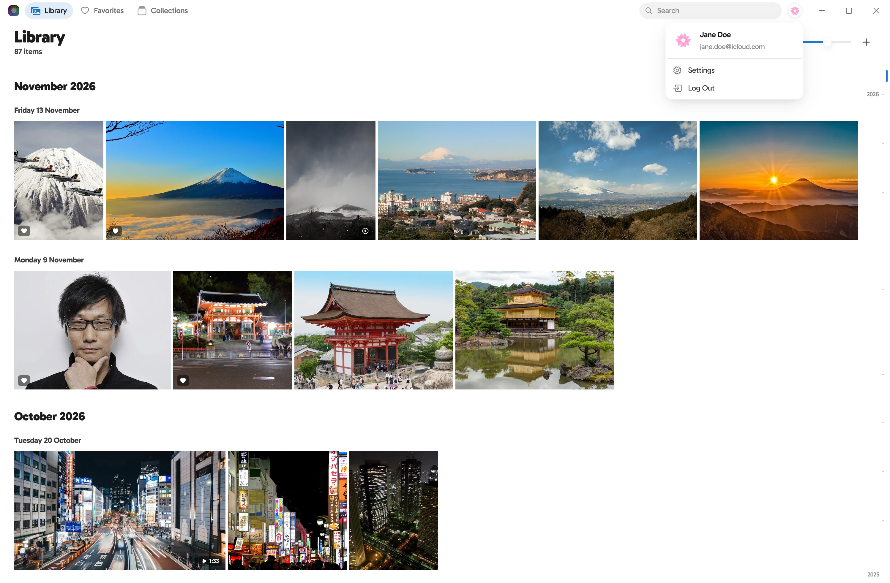
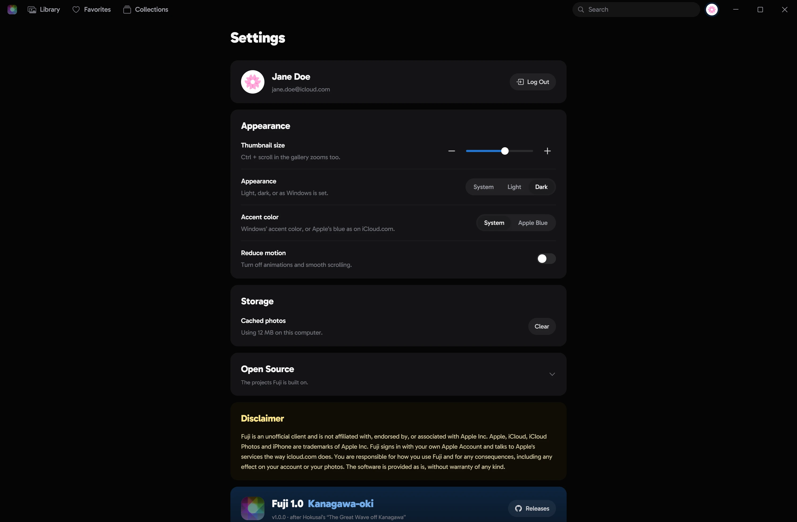

# Fuji

A fast, native iCloud Photos client for Windows and Linux, written in Rust
with [GPUI](https://gpui.rs). Your photos, without a Mac.

Apple makes Photos only for its own platforms. On Windows, iCloud for Windows
just syncs a folder, and Linux has nothing. I wanted a real photo library app
instead, so I made one.

Made by [inane.tools](https://inane.tools).


> ### ⚠️ Disclaimer
> Fuji is an unofficial client and is **not affiliated with, endorsed by, or
> associated with Apple Inc**. Apple, iCloud, iCloud Photos and iPhone are
> trademarks of Apple Inc. Fuji uses the same private web services as
> icloud.com, which Apple can change at any time. To use Fuji, you need your
> **own Apple Account**. You are responsible for how you use it and for any
> consequences, including any effect on your account or your photos. The
> software is provided **as is**, without warranty of any kind.

## What does it do?

- Browse your whole library as a justified mosaic under month and day
  headers, with a zoom slider and a timeline scrubber for jumping through the
  years. It opens instantly from a cached index and refreshes in the
  background.
- Open Memories, your albums, shared albums, media types (Videos, Live Photos,
  Portrait, Panoramas, Slo-mo, Screenshots and more), Hidden and Recently
  Deleted.
- View full-size photos with zoom and pan, play videos with sound, and see a
  photo's camera, lens, exposure, location and the app that saved it. Live
  Photos play their motion.
- Search by date (“march 2021”), type, favorites or file name as you type.
  Paired with your iPhone, Fuji asks it too, as icloud.com does, so “dog” or
  “beach” finds what the phone's on-device index knows.
- Copy, download originals, drag photos out to other apps, and upload with
  the button, by dropping files or folders, or by pasting.
- Favorite, and delete with a few seconds to undo. Changes made on other
  devices show up within seconds.
- Use light or dark mode, Windows' accent color or Apple's blue, and a custom
  title bar that still snaps and drags like any window.

| | |
| --- | --- |
|  |  |
|  |  |

The screenshots show a made-up library of public-domain and CC0 photos
([credits](docs/screenshots/CREDITS.md)). Not yet: hiding, adding to albums,
People and Trips (not on the web), and the iCloud Shared Library. See the
[changelog](CHANGELOG.md) for what's changed.

## Download

Get the latest version from [GitHub Releases](https://github.com/inane-tools/fuji/releases/latest).

- **Windows:** the x64 setup installer. It installs for your account only, with
  no administrator rights needed. It isn't code-signed yet, so SmartScreen may
  warn: choose **More info → Run anyway**.
- **Linux:** an x86_64 AppImage (make it executable and run it) or Flatpak
  bundle (`flatpak install --user fuji-linux-x86_64.flatpak`). Fuji isn't on
  Flathub. Video playback is Windows-only for now.

Windows and AppImage builds check GitHub for updates and install them when you
choose (Settings → About). Flatpak updates are installed manually.

Sign in with your Apple Account. Fuji asks your devices to approve the sign-in,
as a new browser does, and approving it also pairs Fuji with your iPhone for
search. With **Advanced Data Protection** on, “Access iCloud Data on the Web”
has to be enabled on one of your devices.

Each minor version is named after one of Hokusai's *Thirty-six Views of Mount
Fuji*, in the series' order; 1.0 is **Kanagawa-oki**, *The Great Wave off
Kanagawa*.

## Privacy

Fuji talks only to Apple's iCloud services: no telemetry, no server of its
own. It also asks GitHub for new releases (turn that off in Settings → About),
and “Show on map” opens OpenStreetMap in your browser. Session tokens, the
cookie key and the iPhone pairing key live in the system's credential store
(Windows Credential Manager, or the Secret Service on Linux). Thumbnails,
previews and the index are cached locally, and Settings can clear them. A
crash writes `crash.log` to the same folder; nothing is sent anywhere.

## Keyboard shortcuts

| Where | Keys |
| --- | --- |
| Anywhere | Ctrl+F search, Esc to clear it |
| Gallery | Ctrl+A select all, Ctrl+C copy, Ctrl+S download, Ctrl+V paste to upload, . favorite, Del delete, Esc clear the selection |
| Gallery zoom | Ctrl+scroll, Ctrl+= and Ctrl+-, Ctrl+0 to reset |
| Viewer | ← → previous and next, Esc close, + − 0 zoom (or double-click), Ctrl+C copy, Ctrl+S download, . favorite, Space play or pause |

## Develop

Fuji uses Rust (stable; see `rust-toolchain.toml`) and GPUI. `crates/fuji` is
the app, and `crates/fuji-icloud` the iCloud side with no UI.

```sh
cargo run --release -p fuji
```

```sh
cargo test
cargo clippy --all-targets
cargo fmt
```

**Windows** needs the MSVC build tools. Keep the checkout at a short path, or
set `CARGO_TARGET_DIR` to one such as `C:\t\fuji`: build files nest deeply and
fail to link past Windows' 260-character limit. **Linux** needs Vulkan drivers
and the Wayland/X11 headers, for example on Debian or Ubuntu:

```sh
sudo apt install libvulkan1 libxkbcommon-dev libxkbcommon-x11-dev libwayland-dev libx11-xcb-dev libfontconfig-dev libudev-dev
```

Tests marked `#[ignore]` talk to Apple and print only counts;
`live_upload_delete` uploads and deletes a test image, so run it only on
purpose. GPUI is pinned to an exact version; upgrade it on purpose.
`FUJI_DEBUG=1` logs the sign-in and session flow. For releases, see
[packaging and releases](docs/releasing.md).

## Who built Fuji?

Fuji is developed with LLMs, guided by [inane.tools](https://inane.tools).
Claude Code with Claude Opus 5.5 has written it since the first commit, with a
little help from Claude Fable 5.2.

Built on [GPUI](https://github.com/zed-industries/zed) (Apache-2.0), with
[Framework7 Icons](https://framework7.io/icons/) (MIT), the
[Boxicons](https://github.com/box-icons/boxicons) GitHub mark and Bluesky's
own mark (both MIT), and [Gabarito](https://github.com/naipefoundry/gabarito)
(SIL Open Font License), its letter spacing tightened by
`scripts/track_font.py`. Settings lists everything else, with licenses.

## License

[MIT](LICENSE) © 2026 [inane.tools](https://inane.tools)
