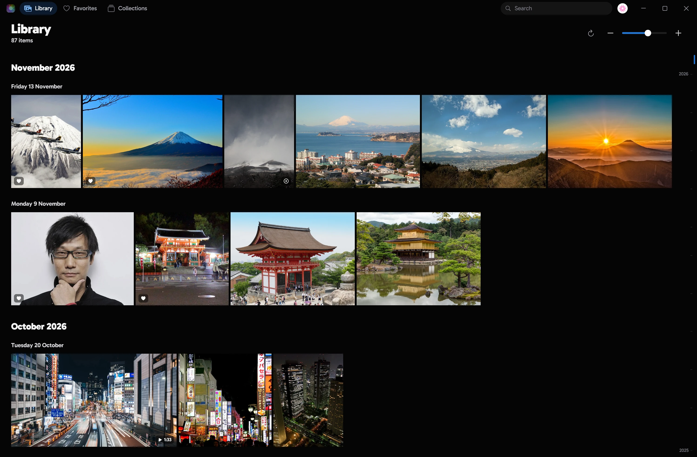
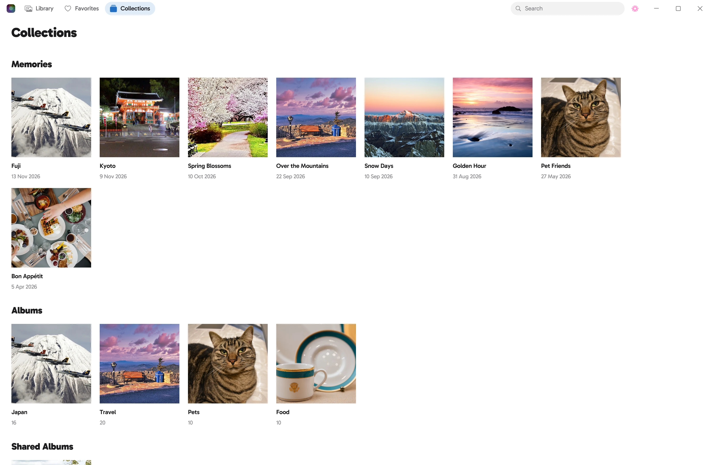
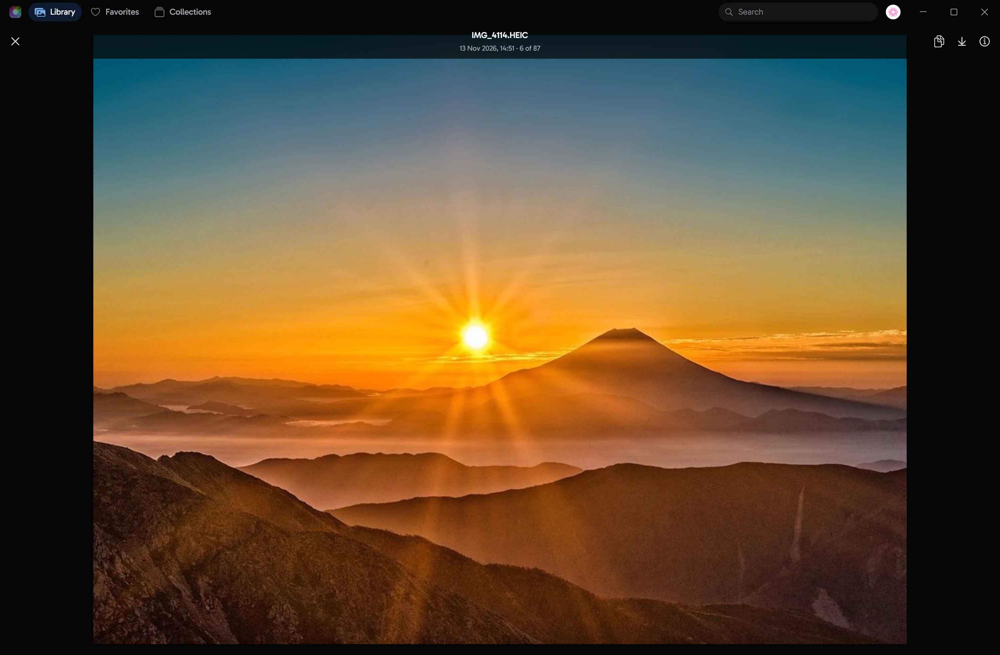

# Fuji

A fast, native **iCloud Photos** client for Windows and Linux, written in Rust
with [GPUI](https://gpui.rs).

Apple makes Photos only for its own platforms. On Windows the official option,
iCloud for Windows, syncs a folder; Linux has nothing. Fuji is a real photo
library app instead: browse, search, view, play, download and upload your
iCloud library, without a Mac.

**Version 1.0, “Kanagawa-oki”.** Each release is named after one of Hokusai's
*Thirty-six Views of Mount Fuji*.



> Fuji is unofficial and isn't affiliated with or endorsed by Apple. It uses
> the same private web services as icloud.com, which Apple can change at any
> time. See the [disclaimer](#disclaimer).

## Features

- **Library:** your whole library as a justified mosaic under month and day
  headers, with smooth scrolling, a zoom slider (or Ctrl+scroll), and a
  timeline scrubber for jumping through the years. The index is cached, so it
  opens instantly and refreshes in the background.
- **Collections:** Memories, your albums, shared albums, media types (Videos,
  Live Photos, Portrait, Panoramas, Slo-mo, Screenshots and more), Hidden and
  Recently Deleted.
- **Viewer:** full-size photos with zoom and pan, video playback with sound,
  a filmstrip of nearby photos, and an info panel: camera, lens, exposure,
  location and the app that saved it.
- **Search:** by date (“march 2021”), type (“videos”), favorites or file
  name, as you type. Paired with your iPhone, Fuji also asks it, just as
  icloud.com does, so searches like “dog” or “beach” find what the phone's
  on-device index knows.
- **Getting photos out and in:** copy (images and files), download originals,
  drag photos out to other apps, and paste to upload.
- **Looks like it belongs:** light and dark mode, Windows' accent color or
  Apple's blue, and a custom title bar that still snaps and drags like any
  window.

| | |
| --- | --- |
|  |  |
|  |  |

The screenshots show a made-up library; its photos are public domain or CC0
([credits](docs/screenshots/CREDITS.md)).

Not yet: Live Photo motion, editing (favorite, hide, delete, add to album),
People and Trips (not available on the web), and the iCloud Shared Library.

## Getting started

Fuji is built from source for now.

1. Install [Rust](https://rustup.rs) (stable; see `rust-toolchain.toml`).
2. Clone this repository and run:

   ```sh
   cargo run --release -p fuji
   ```

3. Sign in with your Apple Account. Fuji asks your devices to approve the
   sign-in, the same way a new browser does; enter the code shown on your
   iPhone. Approving this way also pairs Fuji with the iPhone for search.

**Windows** needs the MSVC build tools. Keep the checkout at a short path:
build files nest deeply and fail to link past Windows' 260-character path
limit. If that happens, set `CARGO_TARGET_DIR` to a short folder such as
`C:\t\fuji`.

**Linux** needs Vulkan drivers and the Wayland/X11 development headers, for
example on Debian or Ubuntu:

```sh
sudo apt install libvulkan1 libxkbcommon-dev libxkbcommon-x11-dev libwayland-dev libx11-xcb-dev libfontconfig-dev
```

Linux builds aren't tested regularly yet, and video playback is Windows-only
for now.

**Advanced Data Protection:** with it turned on, web access works only if
“Access iCloud Data on the Web” is enabled on one of your devices.

## Keyboard shortcuts

| Where | Keys |
| --- | --- |
| Anywhere | Ctrl+F search, Esc to clear it |
| Gallery | Ctrl+A select all, Ctrl+C copy, Ctrl+S download, Ctrl+V paste to upload, Esc clear the selection |
| Gallery zoom | Ctrl+scroll, Ctrl+= and Ctrl+-, Ctrl+0 to reset |
| Viewer | ← → previous and next, Esc close, + − 0 zoom (or double-click), Ctrl+C copy, Ctrl+S download, Space play or pause |

## Privacy

- Fuji talks only to Apple's iCloud services. There's no telemetry and no
  server of its own. The one exception is “Show on map” in a photo's info,
  which opens OpenStreetMap in your browser when you click it.
- Your session tokens, the key that encrypts your saved cookies, and the
  iPhone pairing key are kept in the system's credential store (Windows
  Credential Manager, or the Secret Service on Linux), never in plain files.
- Thumbnails, previews and the library index are cached in your local
  app-data folder, and Settings shows how much space they use and can clear it.

## Development

| Crate | What it is |
| --- | --- |
| `crates/fuji` | The desktop app (GPUI) |
| `crates/fuji-icloud` | The iCloud side, with no UI: sign-in, Photos queries, shared albums, memories, device search |

```sh
cargo test                    # unit tests
cargo clippy --all-targets    # lints
cargo fmt                     # formatting
```

A few tests are marked `#[ignore]` because they talk to Apple. Some use a
made-up address; others read (never change) the library of the account you
signed in to Fuji with, and print only counts:

```sh
cargo test -p fuji live_collections -- --ignored --nocapture
```

GPUI is pre-1.0, so it's pinned to an exact version in the workspace
`Cargo.toml`; upgrade it on purpose. Run with `FUJI_DEBUG=1` to log the sign-in
and session flow.

## Credits

- [GPUI](https://github.com/zed-industries/zed) (Apache-2.0), the UI framework.
- [Framework7 Icons](https://framework7.io/icons/) (MIT), in
  `crates/fuji/assets/icons`; the GitHub mark is
  [Boxicons](https://github.com/box-icons/boxicons)' and the Bluesky mark is
  Bluesky's own (both MIT).
- [Gabarito](https://github.com/naipefoundry/gabarito) (SIL Open Font License),
  with its letter spacing tightened by `scripts/track_font.py`, in
  `crates/fuji/assets`.
- Settings lists everything else Fuji is built on, with licenses.

## License

[MIT](LICENSE), © 2026 inane.tools.

## Disclaimer

Fuji is an unofficial client and is not affiliated with, endorsed by, or
associated with Apple Inc. Apple, iCloud, iCloud Photos and iPhone are
trademarks of Apple Inc. Fuji signs in with your own Apple Account and talks
to Apple's services the way icloud.com does. You are responsible for how you
use Fuji and for any consequences, including any effect on your account or
your photos. The software is provided as is, without warranty of any kind.
